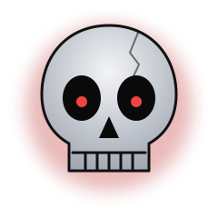

  

 

Hey, I'm **Jexk**, a developer from Jakarta, Indonesia.

I build web apps and tools with **Next.js**, React and Node.js, and I learn something new with every project. Most of what I make starts from one small, annoying problem and ends as something that just works.

Still learning, still shipping. Take a look at my portfolio: **[jexkpinkman.qzz.io](https://jexkpinkman.qzz.io)**

 

  
  

 

 

  

Got an idea or found something broken? Open an issue or say hi.

  

<code>// still shipping</code>

  

